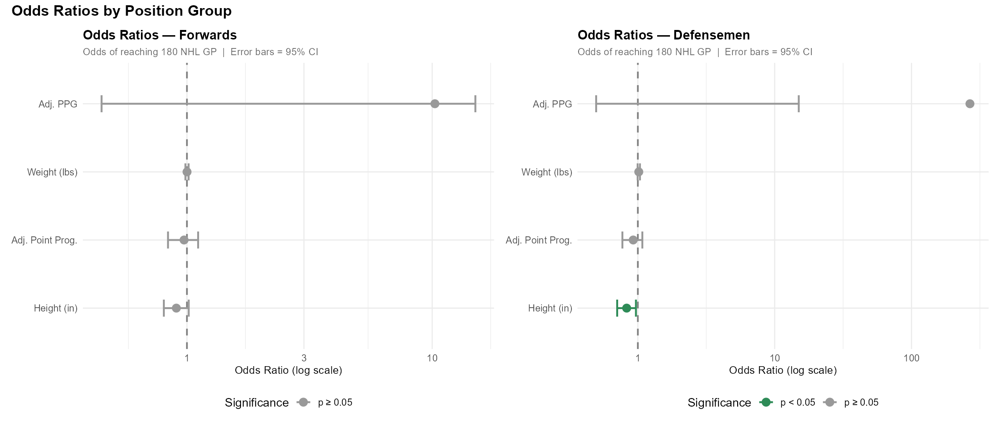

# Uncovering Late-Round Success: Finding Value in the NHL Draft

Capstone project, M.S. Sports Analytics, University of Mississippi.
Author: Josh Hutchings | Faculty advisor: Ben Carter

## Research question
Do pre-draft physical traits or competition-adjusted amateur statistics predict whether a
4th-7th round NHL draft pick (2005-2019) becomes a "draft hit," defined as 180+ NHL regular
season games played?

## Findings
Height was the only significant predictor and it was only for defensemen. For each additional
inch of height it reduced a player's odds of being a draft hit by 17% (OR = 0.828, p = .019). 
All other predictors did not reach a level of statistical significance. The findings 
do support the stated post lockout change emphasizing speed and skill and not size.

## Paper
[Read the full paper (PDF)](paper/Capstone_Hutchings.pdf)

## Video presentation of this project
https://youtu.be/VahcY7i9OOQ

## Plot


## Repository layout
```
data/OMG_Final_Data.xlsx          # analysis dataset (one row per drafted skater)
scripts/01_position_split_models.R # separate models for forwards and defensemen
output/                           # plots are written here when the scripts run
paper/                             #Full Capstone paper
```

## How to run
1. Open R/RStudio with the repository root as the working directory.
2. `source("scripts/01_position_split_models.R")`

Packages (auto-installed if missing): `readxl`, `dplyr`, `ggplot2`, `pROC`, `broom`, `car`, `patchwork`.

## Data
Draft and career NHL data from hockey-reference.com, amateur statistics from EliteProspects,
draft-year height/weight from the NHL API. Amateur production is converted to per-game rates
and scaled with Patrick Bacon's NHL Equivalency (NHLe) factors so leagues are comparable. All
data compiled from publicly available sources for academic, non-commercial use.

Key columns: `Pos`, `Age`, `Height (inches)`, `Weight (lbs)`, `DRAFT_HIT?` (outcome),
`PRE_PPG_ADJ` (adjusted points per game), `PRE_POINT_PROG_ADJ` (adjusted point progression).
`PRE_GPG_ADJ` / `PRE_APG_ADJ` are in the file but excluded from models (see below).
`NHL_WIN_SHARES_PER GAME` is present but not used in any analysis.

## Modeling decisions
- **Outcome:** `DRAFT_HIT` = 1 if >= 180 NHL games, else 0.
- **Dropped GPG_ADJ and APG_ADJ:** PPG = GPG + APG, so including all three produced VIFs in the
  hundreds of thousands and unstable (Inf) coefficients. Only PPG_ADJ is kept.
- **Dropped 14 players with PPG_ADJ = 0** (no pre-draft statistical record), which caused
  complete separation in an earlier run. Analytic sample: 1,538 players, 197 hits (12.8%).
- **Position split:** defensemen = `D`; forwards = `C`, `LW`, `RW`, `W`, `F`, `C/LW`, `C/RW`.
  Age is not used in the models.

## Results summary
| Model | N | Hits | Height OR (p) | AUC | Nagelkerke R2 |
|---|---|---|---|---|---|
| Forwards | 952 | 126 | 0.905 (.095) | 0.575 | 0.018 |
| Defensemen | 586 | 71 | 0.828 (.019) | 0.622 | 0.041 |

Height is the only predictor significant at p < .05 (negative direction: taller players are less
likely to reach 180 games), and it reaches significance only among defensemen. Adjusted PPG trends
positive but is not significant in any model. Hosmer-Lemeshow tests indicate adequate fit in both
models.

## Limitations
- 2017-2019 draftees may not have had time to reach 180 games.
- Few hits per group (especially defensemen) limits statistical power.
